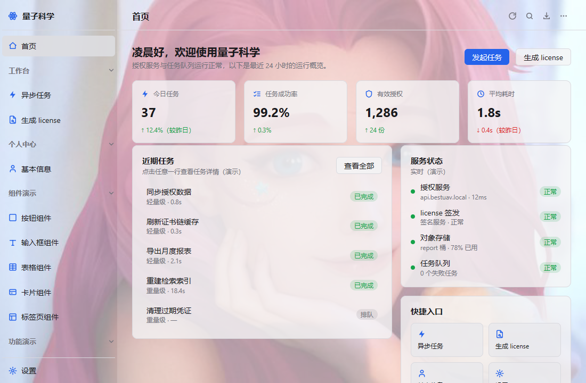
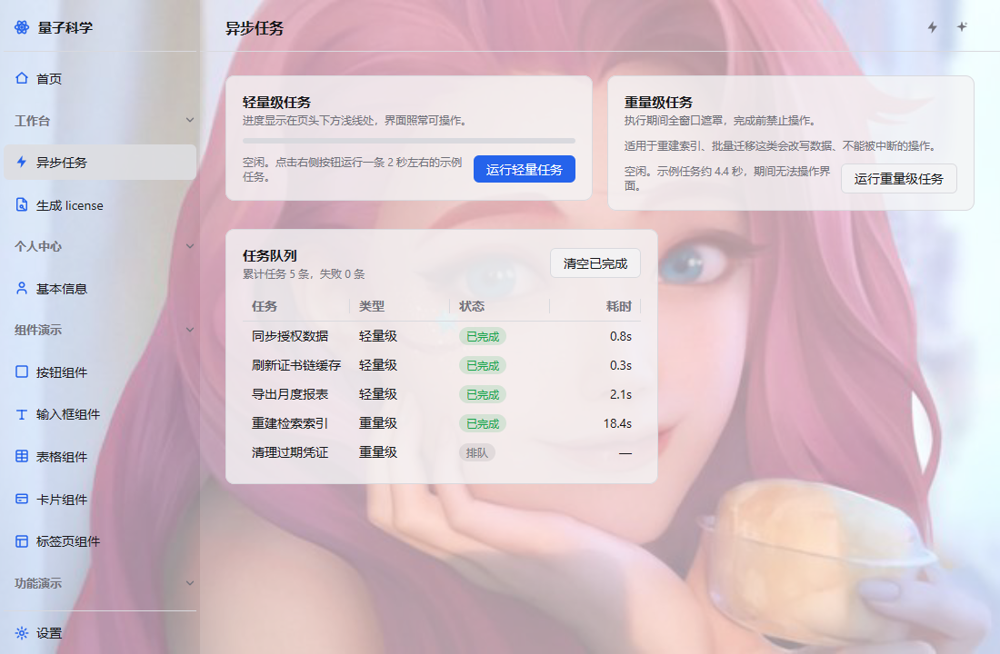
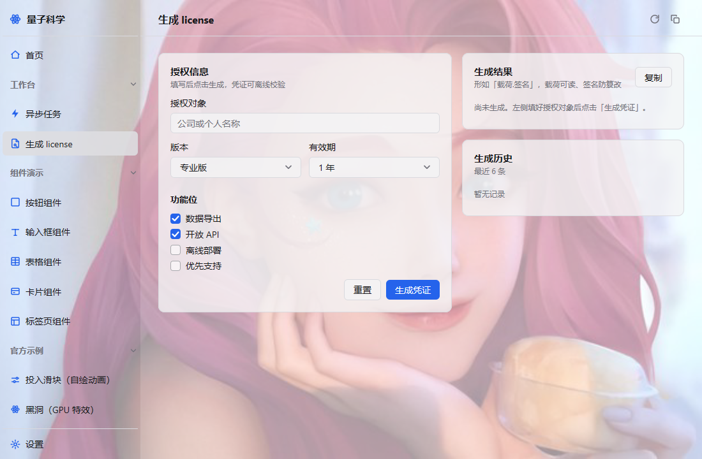
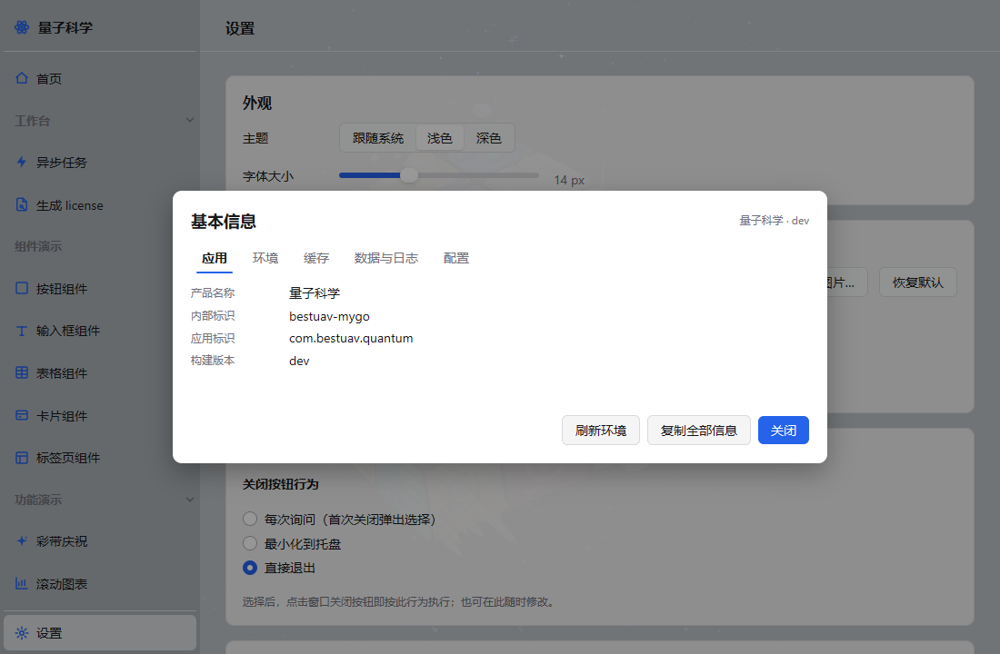
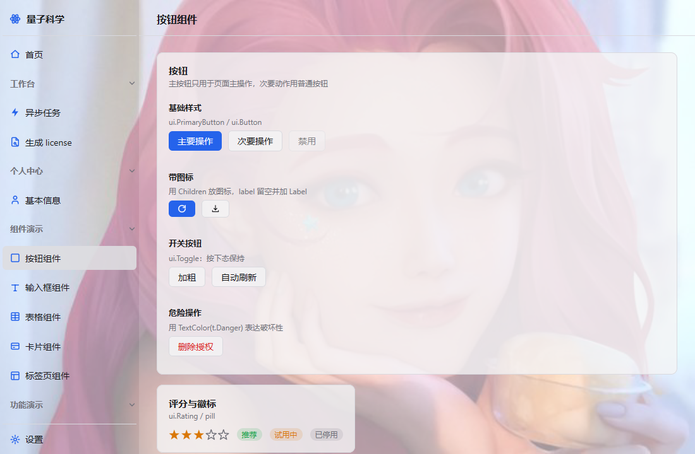
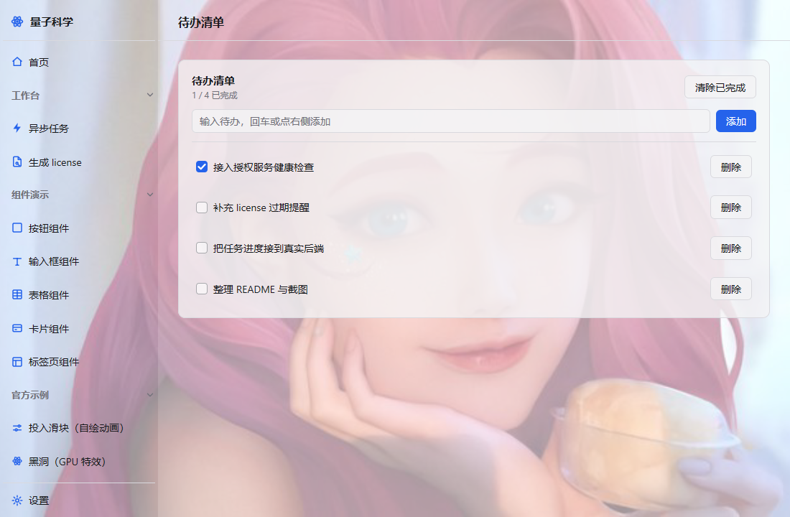
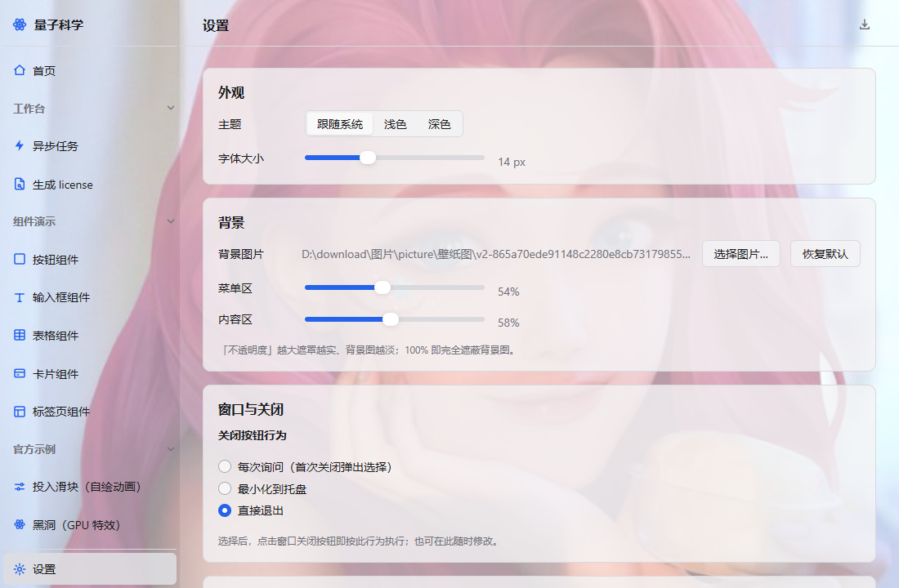
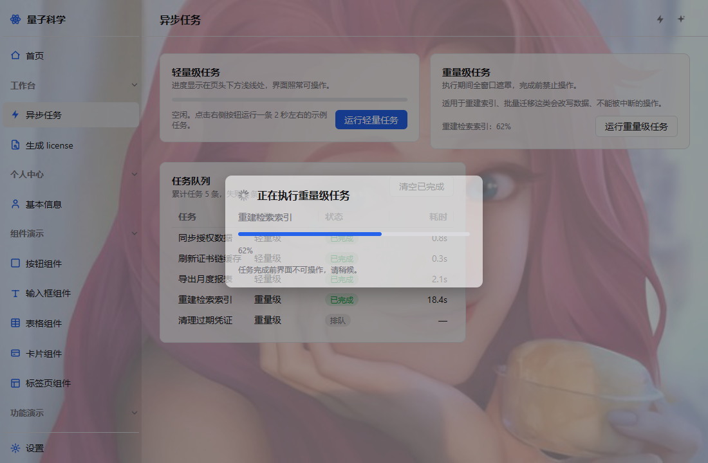

# 量子科学 · bestuav-mygo

> 基于 [mygo](https://github.com/egoist/mygo) 的纯 Go 原生桌面应用。GPU 自绘、无 webview、跨平台（Windows / macOS / Linux）。

---

## 一、项目简介

`bestuav-mygo` 是「量子科学」业务系统的桌面端，采用 Go 原生 UI 框架 [mygo](https://github.com/egoist/mygo)（v0.7.1）开发。

当前项目处于**骨架成型、业务待填充**阶段：

- ✅ 整体应用布局（系统标题栏 + 左侧分组导航 + 右侧内容区）
- ✅ 内容区**固定页头**：左侧页面标题 + 右侧自定义图标工具条（按钮多时可横向滚动，滚动条不可见）
- ✅ 内容区**浅分割线**：与侧栏品牌头下的浅线严格同高，并兼作**轻量级任务进度条**的位置
- ✅ **页面注册表**：菜单 / 页面 / 页头按钮集中在一处声明，新增页面只改一个文件
- ✅ **页面生命周期**：缓存复用、进入即刷新、离开即销毁、闲置超时销毁，可逐页配置
- ✅ 跟随系统明暗主题（不自定义标题栏、不使用固定强调色）
- ✅ 左侧菜单按功能域重排、可折叠、展开可滚动、设置项固定底部
- ✅ 侧栏可整体收缩为图标栏（点击品牌头切换，仅图标 + 悬浮提示，状态持久化）
- ✅ **首页**：欢迎区 + 4 个 KPI（含环比）+ 近期任务 + 服务状态 + 快捷入口
- ✅ **异步任务**：轻量级（页头进度条）/ 重量级（全窗口遮罩、完成前禁止操作），完成时撒彩带
- ✅ **生成 license**：表单 → 本地 HMAC 签名 → 结果自校验 + 复制 + 历史（纯 Go 实现，可单测）
- ✅ **基本信息**（**不占菜单**）：设置 →「关于」→「查看」，弹窗内分页签展示应用标识 / 运行环境 / 页面缓存实时状态 / 数据库与日志路径 / 配置文件
- ✅ **组件演示**（按钮、输入框、表格、卡片、标签页）与**功能演示**（彩带、滚动图表、待办、虚拟列表、动画时间线）
- ✅ **背景图片** + **菜单区 / 内容区分区透明度**（卡片 / 按钮随主题一并半透明，不遮挡背景）
- ✅ 关闭按钮行为可配置；单实例 / 多实例可选（默认单实例）
- ✅ 产品标识字符串集中到 `internal/appmeta`，改名一处生效
- ✅ 标准 Go 目录结构 + 三平台打包脚本

## 一之二、界面截图

> 以下截图均由 `ui.NewTester` 离屏渲染生成（无需显示器），脚本见文末「如何产出截图」。
> 截图里的背景图是本地配置的壁纸，说明「背景图 + 分区透明度」整条链路在工作。

| 首页 | 异步任务 |
|---|---|
|  |  |

| 生成 license | 基本信息（设置 →「关于」→「查看」） |
|---|---|
|  |  |

| 组件演示 | 功能演示（待办） |
|---|---|
|  |  |

| 设置 | 重量级任务遮罩 |
|---|---|
|  |  |

| 彩带庆祝（点击后 0.5s） |
|---|
|  |

---

## 二、技术栈

| 项 | 选型                                                                                      |
|---|-------------------------------------------------------------------------------------------|
| 语言 | Go 1.27+（CGO **不**需要，纯 Go 交叉编译）                                                |
| UI 框架 | [egoist/mygo](https://github.com/egoist/mygo) v0.7.1（即时模式 UI，GPU 自绘，无 webview） |
| 图标 | 内联 SVG（`ui.MustParseSVG`），线性 + `currentColor` 风格（Lucide 思路）                  |
| 持久化 | SQLite（`modernc.org/sqlite`，**纯 Go 无 cgo**）：任务 / 授权记录 / 应用事件               |
| 日志 | 标准库 `log/slog`（JSON 每行一条）+ 按天轮转保留 7 天 + 崩溃堆栈 + 启动环境快照             |
| 打包 | mygo CLI（`go tool mygo build`），纯 Go 跨平台编译                                        |
| 测试 | `ui.NewTester` 无窗口渲染断言（文本 / 交互 / 像素级几何），不依赖显示器                      |

---

## 三、目录结构（最终结构，B 方案：入口留根）

```
bestuav-mygo/
├── main.go                     # 极薄入口（package main）：单实例锁 + WhenReady + NewWindow + 托盘 + 图标 + 注入重绘触发器
├── mygo.json                   # 打包配置；name/identifier 与 internal/appmeta 的 Title/Identifier 需人工保持一致
├── go.mod / go.sum             # 模块名 bestuav-mygo
├── resources/
│   └── icon.png               # 应用图标（1024×1024 PNG），构建与运行时共用
├── internal/
│   ├── view/                  # 装配层 + 业务页面（持有 App 状态）
│   │   ├── app.go             #   App 状态 + View 分发 + 主题/字号/背景等每帧同步 + shell 装配
│   │   ├── registry.go        #   ★ 菜单 / 页面 / 页头按钮的唯一注册处 + 页面分发 + navGroups 桥接
│   │   ├── header.go          #   页头工具条（注册表驱动的图标按钮）
│   │   ├── overlay.go         #   窗口级浮层：弹窗、toast、重量级遮罩、彩带
│   │   ├── pagelife.go        #   ★ 页面生命周期：缓存、进入即刷新、闲置销毁、滚动位置
│   │   ├── persist.go         #   界面状态 ↔ SQLite 的胶水层（读库恢复、写入双写、空库退化）
│   │   ├── shell/             #   ★★ 架构骨架：低频改动、一改全局（不认识任何业务页）
│   │   │   ├── layout.go      #     几何常量（页头高 / 分割线槽位 / 侧栏宽）+ 隐藏滚动条的取巧值
│   │   │   ├── sidebar.go     #     侧栏：品牌头 + 分组导航 + 底部固定项（状态靠 *NavState 指针注入）
│   │   │   └── content.go     #     内容框：页头 / 分割线 / **统一留白的滚动区**
│   │   ├── page_home.go       #   业务页：首页（欢迎区 / KPI / 近期任务 / 服务状态 / 快捷入口）
│   │   ├── page_task.go       #   业务页：异步任务（轻量级 / 重量级 / 任务队列）
│   │   ├── page_license.go    #   业务页：生成 license（表单 → 签名 → 自校验 → 历史）
│   │   ├── basicinfo.go       #   基本信息弹窗（设置页「关于」→「查看」打开）+ 运行环境采集
│   │   ├── page_settings.go   #   业务页：设置（外观 / 背景 / 窗口与关闭 / 启动 / 关于）
│   │   ├── page_demo_widgets.go  # 业务页：组件演示（按钮 / 输入框 / 表格 / 卡片 / 标签页）
│   │   ├── page_demo_features.go # 业务页：功能演示（彩带 / 滚动图表 / 待办 / 虚拟列表 / 时间线）
│   │   ├── page_placeholder.go   # 占位页（注册表里 build == nil 的菜单项落到这里）
│   │   ├── fx/confetti.go     #   彩带引擎（移植自 mygo examples/confetti）
│   │   ├── view_test.go       #   页面渲染 / 几何断言（含「两条分割线同一行」像素断言）
│   │   └── pagelife_test.go   #   生命周期与注册表一致性测试
│   ├── ui/                    # ★★ 自研 UI 资产层：与业务无关、可复用
│   │   ├── icons/icons.go     #   Lucide 风格 SVG 图标集（导出名如 icons.Home）
│   │   └── kit/               #   设计系统：间距规格 + 通用构件
│   │       ├── layout.go      #     全局间距/圆角常量（**唯一真源**，页面禁止硬编码数字）
│   │       └── kit.go         #     Card / Section / CardHeader / RowGrid / Pill / KV / KPICard / StatRow / EmptyHint
│   ├── apppath/               # 路径唯一来源：配置目录 / 日志目录 / 数据库路径
│   ├── logging/               # 日志：slog JSON + 按天轮转 + 崩溃捕获 + 环境快照（零第三方依赖）
│   ├── store/                 # SQLite 持久化：task / license_record / app_event（纯 Go 驱动）
│   ├── appmeta/               # 产品标识常量（名称/标题/应用标识）——改一处全项目生效
│   ├── license/               # license 生成与校验（HMAC-SHA256 + base64url，纯 Go，可单测）
│   ├── crypto/                # 业务包：公钥私钥 / 密码生成（占位）
│   ├── tasks/                 # 业务包：异步任务调度（占位）
│   └── settings/              # 业务包：设置持久化（含存取/迁移/归一化测试）
├── docs/
│   ├── screenshots/           # README 用的界面截图（离屏渲染产出）
│   └── 20261029_*.md          # 当日改动记录
├── scripts/                   # 三平台打包脚本（注释详尽）
│   ├── build-windows.ps1      #   Windows：裸 exe + NSIS 安装包
│   ├── build-macos.sh         #   macOS：.app + .dmg（需 macOS 环境）
│   └── build-linux.sh         #   Linux：裸二进制 + .deb + 便携 tar.gz（需 Linux 环境）
├── docs/                      # 设计 / 重构 / 验证记录
├── .agents/                   # WorkBuddy 维护技能
└── .gitignore
```

### 依赖方向（无环）

```
main → internal/view → { view/shell, ui/kit, ui/icons, store, logging,
                         license, crypto, tasks, settings, appmeta, apppath }
internal/view/shell → { ui/kit, ui/icons }
internal/ui/kit、internal/ui/icons → 只依赖 mygo 的 ui 包
internal/store → apppath（只取路径；不依赖 ui / view / logging）
internal/logging → appmeta、apppath（不依赖 store / view，靠 Recorder 回调入库）
```

- **分层原则**：`ui/`（资产与设计系统）← `view/shell`（架构骨架）← `view`（业务装配）。
  上层可以 import 下层，**下层绝不 import 上层**。
- `view/shell` 与业务解耦的方式是**指针状态 + 回调**：侧栏只知道「当前页 id、是否折叠、
  分组折叠表」这些指针（`*string` / `*bool` / `map[string]bool`），改动直接写回 `App` 的
  字段，因此 shell 不必 import `view`，也就没有包循环依赖。
- 业务页面（`page_*.go`）与 `App` 同包：页面天然要读写大量 App 字段，若强行拆包就必须
  把几十个字段导出或包一层巨大的接口——那是**过度设计**，反而更难维护。Go 的包 = 目录，
  所以这里用 `page_` 前缀做「业务层」的显式归类。
- `internal/view` 持有 `App` 状态与所有视图；纯业务包（`license/crypto/tasks/settings`）
  **绝不**反向 `import ui` 或 `view`，以保证可脱离窗口独立单测。
- `internal/appmeta` 只放常量，不依赖任何包，可被任意层引用（含 `main`）。

### mygo.json 字段说明

`mygo.json` 是 **mygo CLI 的构建/打包配置**（不是应用运行时配置）：`go tool mygo dev` 与 `go tool mygo build` 读它来决定应用叫什么、产物写到哪、安装包元数据怎么写。所有字段都可省略，缺省值见下表。

本项目当前使用的字段：

| 字段 | 当前值 | 作用 | 缺省值 |
|---|---|---|---|
| `name` | `量子科学` | 应用**显示名**：安装后在应用列表 / Dock / 开始菜单里看到的名字，也是窗口标题的默认来源。 | 项目目录名 |
| `slug` | `quantum` | 应用**文件名的 ASCII 短名**：macOS 磁盘镜像、Windows 安装包、Linux 可执行文件与 `.desktop`/`.deb`、更新包等都用它。只允许小写字母、数字、连字符。 | 由 `name` 转写（如「量子科学」→ `liang-zi-ke-xue` 之类） |
| `identifier` | `com.bestuav.quantum` | **反向 DNS 包标识**：macOS bundle id、Windows 安装标识；mygo 的单实例锁 key 也包含它。全平台唯一，发布后不应再改。 | 无（强烈建议显式写） |
| `version` | `0.1.0` | 版本号，写进各平台安装包元数据；升级判定也用它。 | `0.0.0` 类默认 |
| `publisher` | `BestUAV` | 发布者：Windows「应用和功能」里显示的公司名。 | 从 `copyright` 去掉「©」与年份推导 |
| `copyright` | `Copyright © 2026 BestUAV` | 版权声明，写入安装包与应用信息。 | 空 |
| `out` | `build` | **构建产物目录**（三个打包脚本都从这里取产物、往这里写）。 | `dist` |

可选、本项目暂未使用但值得知道的字段：

| 字段 | 作用 |
|---|---|
| `icon` | 方形 PNG 图标路径；缺省自动用 `resources/icon.png`，若存在同名 `-dev`（如 `icon-dev.png`）则 `mygo dev` 优先用它。 |
| `main` | Go 入口包路径，缺省 `"."`（仓库根）。**本项目「入口留根」方案依赖这个缺省值**，故意不写。 |
| `resources` | 额外随包分发的文件/目录；`resources/` 目录内容始终会被打进去。 |
| `urlSchemes` / `fileAssociations` | 自定义 URL scheme（深链）与文件关联，运行期回调到 `App.OnOpenURL` / `App.OnOpenFile`。 |
| `i18n` | 多语言消息目录；不配则只带英文。 |
| `updates` | 签名更新的配置，配合 `mygo.Updater`。 |
| `macos` / `windows` / `linux` | 各平台专属段（如最低系统版本、安装包行为、权限声明）。 |
| `devUrl` / `devCommand` / `buildCommand` / `frontendDist` / `bindings` | WebView 前端项目的开发与构建接线；**本项目是原生 UI、无前端，全部不需要**。 |

> ⚠️ **与 `internal/appmeta` 的关系**：Go 代码里的产品标识取自 `internal/appmeta`（`Name` / `Title` / `Identifier`），而打包用的 `mygo.json` 由 CLI 独立读取，两者**无法自动同步**。改名时的对照关系：
>
> - `mygo.json` 的 `name` ≡ `appmeta.Title`
> - `mygo.json` 的 `identifier` ≡ `appmeta.Identifier`
> - `appmeta.Name` 是配置目录名与窗口状态键，语义接近 `slug`，目前仍是 `bestuav-mygo`
>
> 也就是说：**改产品名时要动两处**（`appmeta` 与 `mygo.json`），其余代码不用碰。

---

## 四、环境要求

| 依赖         | 说明 |
|--------------|---|
| Go 1.27+     | 构建本项目 |
| mygo CLI     | 已在 `go.mod` 以 `tool github.com/egoist/mygo/cmd/mygo` 声明，直接 `go tool mygo dev/build` 即可（首次运行自动编译，需联网）；亦可 `go install github.com/egoist/mygo/cmd/mygo@latest` |
| Windows 打包 | 本机 `build-windows.ps1`（mygo 原生产出 NSIS `.exe` 安装包） |
| macOS 打包   | 需在 **macOS** 上跑 `build-macos.sh`（`.dmg`/签名需 Xcode + Developer ID） |
| Linux 打包   | 需在 **Linux** 上跑 `build-linux.sh`（`.deb` 需 `dpkg-dev`/`fakeroot`） |

> 裸二进制可跨平台交叉编译；但 **`.dmg` / `.deb` 安装包必须在对应目标系统生成**。

---

## 五、快速开始

```bash
# 1. 安装 mygo CLI（仅需一次）
go install github.com/egoist/mygo/cmd/mygo@latest

# 2. 拉取依赖
go mod download

# 3. 开发模式（热重载，窗口标题栏与任务栏显示图标）
go tool mygo dev

# 4. 运行全部测试（无需显示器）
go test ./...

# 5. 仅编译校验
go build ./... && go vet ./...
```

---

## 六、打包发布

各平台脚本均已写好详细注释（前置依赖、签名、跨平台限制、编码说明）。直接用即可：

### Windows（`build-windows.ps1`）

> ⚠️ **必须先 `cd` 到仓库根目录**（脚本内 `.\mygo.json` 为相对路径）。**不要双击 `.ps1`**，从 PowerShell 终端显式调用。本机若只有 PowerShell 5.1（`powershell.exe`）、未装 PowerShell 7（`pwsh`），请用下面第一条命令。

```powershell
# 推荐：在仓库根目录执行（PowerShell 5.1 也能跑；-ExecutionPolicy Bypass 绕过默认脚本策略）
powershell -ExecutionPolicy Bypass -File scripts/build-windows.ps1

# 若已装 PowerShell 7，也可：
pwsh scripts/build-windows.ps1
```

- **编码说明**：该脚本刻意写成**纯 ASCII**（英文注释 + 英文输出）。原因——Windows PowerShell 5.1 按系统代码页（中文 Windows 为 GBK/CP936）解码 `.ps1`，UTF-8 无 BOM 的中文会被误读、导致字符串引号被提前闭合而报错。若你一定要中文注释，请把文件存为 **UTF-8 带 BOM** 再改。
- 首跑会联网自动下载 NSIS 制作安装包。
- **产出（均在 `build/` 目录）**：
  - `bestuav-mygo-<ver>-windows-amd64.exe`（裸可执行文件）
  - `bestuav-mygo-setup-<ver>-amd64.exe`（NSIS 安装包，双击即可安装）

### macOS（`build-macos.sh`）

```bash
# 必须在 macOS 上执行（.dmg 与签名/公证需 Xcode + Developer ID）
./scripts/build-macos.sh
# 产出（build/）：bestuav-mygo-<ver>-darwin-universal.app + bestuav-mygo-<ver>-darwin-universal.dmg
```

### Linux（`build-linux.sh`）

```bash
# 必须在 Linux 上执行（.deb 需 dpkg-dev / fakeroot）
./scripts/build-linux.sh
# 产出（build/）：bestuav-mygo-<ver>-linux-amd64（裸文件）
#                + bestuav-mygo-<ver>-linux-amd64.deb
#                + bestuav-mygo-<ver>-linux-amd64.tar.gz（含 install.sh，装到 ~/.local）
```

> ⚠️ **关于 `.msi`**：mygo 原生产出的是 **NSIS 制作的 `.exe` 安装包**，并非 `.msi`。若下游强制要求 `.msi`，需另行引入 WiX Toolset 将裸 exe 封装，属于 mygo 标准链路之外的额外步骤（已在 `build-windows.ps1` 注释中说明）。
> ⚠️ **关于安装包平台限制**：裸二进制可跨平台交叉编译，但 `.dmg` / `.deb` 安装包**必须在对应目标系统生成**（`.dmg` 需 macOS，`.deb` 需 Linux）。

---

## 七、设置与持久化

### 7.1 用户偏好：JSON 文件

用户偏好保存在 **per-user 配置目录下的 JSON 文件**（业界桌面应用标准做法，优于数据库）：

- Windows：`%APPDATA%\bestuav-mygo\settings.json`
- macOS：`~/Library/Application Support/bestuav-mygo/settings.json`
- Linux：`~/.config/bestuav-mygo/settings.json`

写入采用「临时文件 + 重命名」原子写，避免写一半断电导致配置损坏；文件缺失或解析失败时回退默认并归一化脏数据（实现见 `internal/settings`）。

> 兼容说明：早期版本把 `settings.json` 直接放在用户配置目录根下（没有按应用名分子目录）。启动时若新位置不存在而旧位置存在，会自动读取旧文件并迁移到新位置，用户偏好不丢。

可配置项（在设置页内修改并即时持久化）：

| 项 | 取值 | 说明 |
|---|---|---|
| `theme` | `system` / `light` / `dark` | 跟随系统 / 浅色 / 深色，运行时切换 |
| `fontSize` | 11–22（px，设置页滑块 11–20） | 文本基准字号，全局生效 |
| `closeMode` | `ask` / `minimize` / `quit` | 关闭按钮行为 |
| `sidebarCollapsed` | `true` / `false` | 侧栏整体是否处于收缩（图标栏）状态；默认 `false`（展开） |
| `allowMultiInstance` | `true` / `false` | 是否允许同时运行多个实例；默认 `false`（单实例），**需重启生效** |
| `backgroundImage` | 图片绝对路径 / `""` | 背景图片；空串表示不使用（主题默认外观） |
| `menuOpacity` | 0.2–1.0 | 侧栏浮层「不透明度」；仅设置背景图后生效，默认 0.80 |
| `contentOpacity` | 0.2–1.0 | 内容区浮层「不透明度」；仅设置背景图后生效，默认 0.88 |
| `pageIdleMinutes` | 0–120 | 页面缓存闲置多少分钟后销毁；默认 15，0 = 不按闲置销毁 |

**侧栏展开 / 收缩**：

- 点击左上角「品牌头」（原子图标）即可在**展开 ↔ 收缩**之间切换：展开为 220px 的「图标 + 文字」布局；收缩为 64px 的图标栏（rail），仅显示图标，鼠标悬停提示菜单名。
- 切换状态即时写入上面的 `settings.json`，**下次启动自动保持现状**。
- 展开时菜单图标、品牌头图标、底部「设置」图标的中心在同一条竖线上。

**背景图片与透明度**：

- 设置页「背景」区可「选择图片…」（系统原生文件选择框）或「恢复默认」（清除背景图并复位两个不透明度）。
- 透明度拆成**菜单区**与**内容区**两个独立滑块，调节的是「不透明度」：100% = 完全遮蔽背景图，数值越小背景图越透出。
- 实现方式：背景图铺满窗口最底层（`ui.Image(...).Fit(ui.Cover)`），侧栏与内容区各自画一层半透明主题色浮层。未设置背景图时两处浮层恒为不透明，界面与主题默认外观完全一致。

### 7.2 业务数据：SQLite（`internal/store`）

驱动选 **`modernc.org/sqlite`（纯 Go 实现）**：`CGO_ENABLED=0` 保持不变，三平台交叉编译与「单文件二进制」的打包方式不受影响。
代价是二进制约 +7.5MB（14.5MB → 22MB）、性能比 cgo 版低 2–3 倍——对「本地单机、几千行数据」的桌面场景完全够用。

库文件：`<配置目录>/data.db`（WAL 模式 + `synchronous=NORMAL` + `busy_timeout=5000`）。

| 表 | 内容 |
|---|---|
| `task` | 异步任务记录（名称 / 类型 / 状态 / 耗时 / 时间） |
| `license_record` | 授权凭证生成历史（授权对象 / 版本 / 期限 / 凭证 / 时间） |
| `app_event` | 应用事件（INFO 审计 + ERROR/CRASH 错误），供排查与将来「一键导出」 |
| `schema_meta` | 元数据（`schema_version`、演示数据是否已灌入等） |

几条硬约定：

- **数据库是持久化真源，`App.tasks` / `lic.history` 只是本帧要用的缓存**：启动时读库，写入时同时更新内存与库（数据量小，不做脏标记/批量刷盘）。
- **首次运行灌入演示任务用 `schema_meta` 标记，而不是「表为空就灌」**——否则用户清空任务后，下次启动又会被灌回来。
- **库不可用必须优雅退化**：`a.store == nil` 时全部读写走内存，界面照常可用，失败原因写日志。`TestNilStoreDegradesGracefully` 锁定了这条行为。
- `SetMaxOpenConns(1)`：桌面场景只有一个写入者、写入量极小，串行化彻底避免 `SQLITE_BUSY`，调用方不需要加锁。

### 7.3 日志与崩溃记录（`internal/logging`）

- 位置：`<配置目录>/logs/app-YYYY-MM-DD.log`，**按天轮转、保留 7 天**；超过保留期的自动删除，非本包命名的文件一律不动。
- 格式：标准库 `log/slog` 的 **JSON 每行一条**，可直接 grep / 入库；级别 `INFO` / `WARN` / `ERROR` / `CRASH`。零第三方依赖。
- **启动即写环境快照**：应用版本、Go 版本、OS / 架构、CPU 核数与型号、主机名、用户、时区、可执行文件路径、配置/日志/数据库路径、进程内存基线（见 `logging.EnvSnapshot`）。用户报障时不必反复追问环境。
- **崩溃捕获**：`App.View` 顶部 `defer logging.Recover("view")`；后台任务协程各自 `defer logging.Recover(...)`（它们不经过 View）。捕获后写 CRASH（含完整堆栈）**并重新抛出**——只增加可观测性，不改变原有崩溃行为。
- **事件入库规则**：`Event(...)` 只在 **ERROR 及以上**入库（日志文件才是全量）；`Audit(...)` **无条件入库**，用于「启动 / 清空数据 / 生成授权」这类关键动作。
- 界面可见：基本信息弹窗的「数据与日志」页签显示库计数、数据库与日志路径、最近 5 条事件。

**组件为什么不会「挡住」背景图**（`App.applyBackdropTheme`）：

mygo 的主题是**整帧共享**的一份（`c.Theme()` 返回同一个 `*Theme`），所以不去逐个改组件，而是在每帧开始时把主题里的「控件面」颜色统一降透明度，所有从主题取色的组件（`ui.Button`、`ui.Table`、`ui.Segmented`、`ui.Slider`、卡片等）一起变半透明：

| 层级 | 透明度来源 | 说明 |
|---|---|---|
| 内容区浮层 | 内容区不透明度 | 面板本身（`t.Background`） |
| 悬停底 | 浮层 + （控件面−浮层）× 0.35 | 比控件面「虚」一档，让选中项读得出来 |
| 控件面 | 浮层 + （1−浮层）× 0.5 | 卡片 / 按钮 / 输入框 / 表格底，比浮层实一档，保住卡片轮廓 |
| 按下态 | 控件面再向不透明靠一半 | 点击反馈最强 |

- **不参与调整的**：文字（`Text`/`TextMuted`）、描边（`Border`）、强调色与选中态（`Accent`，如表格选中行、开关与进度条）。这些是语义色，半透明会直接损伤可读性；如果你希望连选中行也透出背景，把 `Accent` 也纳入 `applyBackdropTheme` 即可。
- 透明度用**绝对赋值**而非相乘：主题实例跨帧复用，若用乘算会逐帧越来越透明；绝对赋值保证幂等，关掉背景图后界面立刻恢复完全不透明（`TestNoBackdropKeepsOpaque` 守住这条）。
- 层次顺序由 `TestBackdropThemeAlphas` 锁定：浮层 < 悬停 < 控件面 < 按下 ≤ 1。

**多实例**：

- 默认单实例：重复启动的进程会把参数转发给已在运行的实例后退出，首个实例把窗口显示出来（`RequestSingleInstanceLock` + `OnSecondInstance`）。
- 设置页「启动」区打开「允许多开」后，每次启动都是独立窗口；该开关**需重启应用**才生效（单实例锁在进程启动时获取）。

**关闭按钮行为**：

- `ask`（默认）：首次点击关闭弹出选择弹窗（最小化到托盘 / 直接退出），可勾选「记住我的选择」持久化；之后按所选执行，也可在设置页随时改回「每次询问」。
- `minimize`：点击关闭最小化到托盘。
- `quit`：点击关闭直接退出应用。

---

## 八、内容区布局与轻量任务进度

内容区（`internal/view/shell/content.go`）自上而下分三段：

1. **固定页头**（高度 `shell.HeaderHeight = 52`，不参与滚动）：左侧页面标题，右侧「自定义图标按钮」工具条。
   - 工具条放在横向滚动容器里：按钮少时按内容宽度靠右排列；空间不足时被压缩到可用宽度，超出部分**横向滚动**（页头是固定高度的一条，横向滚动条做了隐藏处理，避免破坏对齐）。
   - 每个按钮是 28×28 的点击区，悬停有圆角底色，悬浮提示说明用途；按钮清单按页面在 `registry.go` 的 `navItem.tools` 中声明。
2. **分割线槽位**（高度 `shell.DividerSlot = 3`）：常态画一条 1px 浅线；执行轻量级任务时**同一槽位**改画进度条（`ui.Progress`）。
   - 槽位高度固定，所以进度条出现/消失都不会让下方内容跳动。
   - 这条线与侧栏「品牌头下的浅线」严格同高：两侧都由 `Space(1) + 52` 得出（内容区根容器上内边距 4px + 页头 52px），测试 `TestDividersOnSameRow` 用离屏渲染的真实像素断言二者落在同一行。
3. **可滚动内容区**：`ui.Scroll`，**留白与区块间距由它统一施加**（见下）。

### 8.1 页面留白与间距：由容器统一负责，页面不用管

这是本项目的硬约定——**页面函数只写「区块」，不写外边距**：

| 规格（`internal/ui/kit/layout.go`） | 值 | 作用 |
| :--- | :--- | :--- |
| `kit.PagePadX` | 28 | 内容区左右留白（页头与页面内容共用，保证左边缘对齐） |
| `kit.PagePadY` | 24 | 内容区上下留白 |
| `kit.PageGap` | 16 | 页面内**区块之间**的垂直间距 |
| `kit.RowGap` | 16 | 同一行/同一栅格里并排卡片的间距 |
| `kit.CardGap` / `kit.CardPad` / `kit.CardRadius` | 12 / 18 / 10 | 卡片内部行距、内边距、圆角 |

实现方式：`shell.Content` 把页面内容包进 `ui.Column(c).Gap(kit.PageGap)`，滚动区自己带
`Padding(kit.PagePadY, kit.PagePadX)`。于是：

- **新增页面不需要关心空隙**：直接往页面函数里写 `kit.Card(...)` / `kit.RowGrid(...)`，
  上下留白与区块间距自动一致；
- 全局调整间距只改 `kit/layout.go` 一处，全站同步。

> 反例（改造前的写法，已清除）：各页面自己写 `.Padding(16, 0, 4)`、`.Padding(20, 0, 4)`、
> `.Padding(10, 0)`…导致同一产品里出现 4/10/16/20 四种区块间距，看着"乱"。

### 8.2 同一行等宽等高：用 `kit.RowGrid`，不用 `Row + Grow`

`kit.RowGrid(c, n, fn)` 内部是 `ui.Grid(c).Columns(n).Gap(kit.RowGap)`：列宽 **Fr(1) 严格相等**，
且网格项默认 `Stretch`，所以同一行的卡片**天然等高**。

为什么不用 `Row + Grow(1)`：flex 的 grow 只分配"剩余空间"，各卡片的基础宽度仍由内容决定，
于是文字长短不同就会长出不同宽度（首页 KPI 卡参差的根因）。栅格没有这个问题。

已按此改造：首页 4 张 KPI（`RowGrid(4)`）、异步任务两张任务卡（`RowGrid(2)`）、
卡片演示三卡、输入演示两栏、标签页演示两栏。

### 8.3 滚动条策略

- **内容区：显示**（主题默认样式，悬停/拖动时显现，与系统级 overlay 滚动条一致）；
- **侧栏：隐藏**（菜单再长也不出现滚动条，但仍可滚动）；页头横向工具条同理。
- 实现：mygo 的滚动条颜色来自**全局 Theme**，没有"单容器隐藏"的开关。侧栏改用
  `ScrollbarInsets(0, 400, 0, 0)` 把竖直滚动条推到窗口左边界之外（不可见、不可点），
  内容区不受影响。取值见 `shell.scrollbarHideInset`，原因写在 `shell/layout.go` 注释里。


**接一条真实轻量任务**：

```go
a.startLightTask("导出")   // 任务名会显示在页头标题右侧
// 真实业务把内部模拟循环换成自己的工作；
// 完成后调 a.endTask()（进度归零，分割线恢复常态）
```

进度由后台 goroutine 推进，通过 `SetInvalidator(win.Invalidate)` 注入的重绘触发器请求重绘（`mygo.RunOnMain` 保证在主线程改状态）。

---

## 九、菜单与页面：注册表 + 生命周期

### 9.1 一张表搞定菜单、页面、页头按钮

`internal/view/registry.go` 是**唯一**的注册处。旧做法要在三个地方同步改（侧栏的菜单数组、页头标题 map、页面分发 switch），漏一处就出现「点了没反应」「标题空白」这类假 bug；现在只有一处：

```go
// 1) 写页面函数（新建文件也可以，同包即可）
func (a *App) orderPage(c *ui.Context, t *ui.Theme) {
	card(c, t, func() {
		cardHeader(c, t, "订单管理", "示例页面", nil)
		ui.Text(c, "内容…")
	})
}

// 2) 在 navRegistry() 里加一条
{title: "工作台", items: []navItem{
	{id: "order", label: "订单管理", icon: iconTable, build: (*App).orderPage,
		tools: []toolAction{{icon: iconRefresh, label: "刷新", tip: "刷新订单"}}},
}},
```

加完即生效：侧栏出现菜单项、页头显示标题、页面按 `build` 渲染、页头出现图标按钮。`build` 留空则自动落到占位页（`placeholderPage`），可以先占位后实现。

**几种做法的取舍**（为什么选注册表）：

| 做法 | 新增页面要改几处 | 优点 | 代价 |
|---|---|---|---|
| 分散定义（旧做法） | 3 处 | 无门槛 | 极易漏改，id 靠字符串对齐 |
| **集中注册表（本项目）** | **1 处** | 一目了然、便于校验（`TestRegistryConsistency` 会查 id 唯一/字段完整） | 注册表文件会随页面增多变长 |
| 各页面 `init()` 自注册 | 1 处（新文件内） | 插件化，删文件即删页面 | 顺序/依赖不可见，排查靠搜；测试难枚举 |
| 代码生成（按目录生成） | 0 处（靠目录约定） | 最省手 | 引入生成步骤与产物管理，改动成本高 |

> javafx 版用「注解 + 类扫描」实现自注册（`@Page` + ClassGraph）。Go 没有注解与运行时反射扫描整个包的能力，等价物就是 `init()` 自注册；本项目页面数量在十几个量级，集中注册表的可读性收益更大。若将来页面数到几十个，可以平滑改成「每页一个文件 + init 注册」，注册表退化为空壳。

### 9.2 页面生命周期：缓存还是重新加载

mygo 是**即时模式 UI**：每帧从页面函数重建元素树，**不存在「页面实例」可以缓存**（这点与 javafx 的 Node 缓存模型根本不同）。所以能缓存的是两样东西：

1. 页面业务状态（表单值、已加载数据、任务进度…）；
2. 控件交互状态（滚动位置，用 `ui.ScrollState` 显式接管）。

`internal/view/pagelife.go` 提供三种策略，逐页在注册表里声明：

| 策略 | 行为 | 适用 |
|---|---|---|
| `keepCached`（默认，零值） | 离开保留状态；闲置超过 TTL 销毁 | 大多数业务页 |
| `keepPinned` | 永不销毁 | 首页、设置 |
| `keepFresh` | 离开即销毁，每次进入都是全新页面 | 表单类（生成 license） |

```go
// 缓存 + 每次进入重新采集数据；30 分钟后闲置销毁
policy: pagePolicy{keep: keepCached, idle: 30 * time.Minute,
	onEnter: func(a *App) { a.collectEnv(true) }},
```

钩子：`onEnter`（每次进入，适合「进入即刷新」）、`onLeave`（离开，适合暂停轮询）、`onDestroy`（状态丢弃前，适合释放 goroutine/解码资源）。

**销毁时机有四种**，都可预期：

| 触发 | 说明 |
|---|---|
| `keepFresh` 页面离开 | 立即销毁 |
| 闲置超时 | 默认 15 分钟（设置页可改，0 = 不销毁） |
| 手动 `a.destroyPage(id)` / 设置页「销毁非常驻缓存」 | 立即销毁 |
| 退出应用 | 进程结束，无需处理 |

**页面私有状态**用泛型助手存取，销毁后自动失效（下次进入重新 `init`）：

```go
n := pageData(a, "task", "filter", func() taskFilter { return taskFilter{Kind: "全部"} })
```

**滚动位置**用 `a.ScrollFor(a.page)` + `ui.Scroll(...).TrackScroll(...)` 接管：缓存页切回来停在原处，销毁后归零——这是「缓存」与「重新加载」最直观的差别。基本信息弹窗的「缓存」页签里有一张实时表，能看到每个缓存页的策略、进入次数、闲置时长与滚动位置。

---

## 十、页头图标按钮怎么实现

页头工具条里每个按钮都是**内联 SVG 图标 + 悬停底 + 悬浮提示**，没有图片资源、没有字体图标：

```go
// 1) 图标：internal/ui/icons/icons.go 里一条线性 SVG，stroke=currentColor 自动跟随主题文字色
var Refresh = ui.MustParseSVG([]byte(
	`<svg xmlns="http://www.w3.org/2000/svg" viewBox="0 0 24 24">
	   <path fill="none" stroke="currentColor" stroke-width="2" stroke-linecap="round"
	         d="M21 12a9 9 0 1 1-2.64-6.36M21 3v6h-6"/></svg>`))

// 2) 声明：挂在注册表的 tools 上（label 既是动作名也是默认的轻量任务名）
tools: []toolAction{
	{icon: icons.Refresh, label: "刷新", tip: "刷新概览数据"},
	{icon: icons.Sparkles, label: "演示彩带", tip: "撒一把彩带",
		run: func(a *App) { a.celebrate(4) }}, // 不填 run 时默认跑一条轻量任务
},

// 3) 渲染：header.go 的 toolButton（28×28 点击区 + 悬停底色 + Tooltip）
```

要点：

- **尺寸与对齐**：统一 28×28 点击区、16px 图标，容器用 `ScrollHorizontal + Shrink(1)`——按钮少时靠右，多了自动横向滚动（横向滚动条已隐藏）。
- **提示**：`btn.Tooltip(tip)`，1 秒内出现，适合图标按钮这种「没有文字」的控件。
- **新图标**：往 `internal/ui/icons/icons.go` 的 var 块里加一条即可（导出名以大写开头），尺寸/配色由调用处的 `FontSize/TextColor` 决定（不要写死颜色，否则暗色主题会看不清）。
- **来源**：全部按 Lucide 的线性风格手写（MIT），也可以用任何 24×24 viewBox 的线性 SVG。

---

## 十一、图标说明

- 源文件：`resources/icon.png`（1024×1024 PNG）。
- **运行时**：`main.go` 通过 `//go:embed` 将图标编入二进制，在 `win.OnReadyToShow` 中调用 `(*Window).SetIcon`，保证开发模式（`go tool mygo dev`）窗口标题栏左上角与任务栏图标可见。
- **构建时**：mygo 自动把 `resources/icon.png` 嵌入安装包（Windows `.syso` / macOS `.icns` / Linux `.desktop`）。
- 如需给开发版单独配图标，可放 `resources/icon-dev.png`，mygo 会自动优先采用。

---

## 十二、主题与视觉约定

- 主题来源：默认 `mygo.Theme.SetSource(mygo.ThemeSystem)`——**跟随操作系统明暗**；可在设置页切换为固定浅色 / 深色（`settings.json` 的 `theme`）。
- 不使用自定义强调色与自定义标题栏；侧栏选中态、图标高亮均取自**系统强调色**（`t.Accent`）。
- 图标统一线性 `currentColor` 风格，选中/悬停随系统文字色与强调色自适应。
- **滚动条**：内容区显示（悬停/拖动时显现）；侧栏与页头横向工具条隐藏。侧栏用
  `ScrollbarInsets` 把滚动条推到窗口外实现，详见第「8.3」节——因为 mygo 的滚动条颜色
  是全局 Theme 字段，没有单容器开关。
- **背景图分层**：背景图铺满窗口最底层（`Fit(ui.Cover)`），其上是内容区浮层（`t.Background`）与侧栏浮层（`t.Surface`），再上是卡片 / 按钮等「控件面」，最后是文字与强调色。背景图存在时，浮层与控件面按设置的不透明度逐层半透明（`applyBackdropTheme`）；不存在时全部不透明，与主题默认外观完全一致。

---

## 十三、开发约定

1. **分层与目录**：`internal/ui/{icons,kit}` 是自研 UI 资产与设计系统（与业务无关）；
   `internal/view/shell` 是架构骨架子包（低频改动、一改全局）；业务页面是 `view/page_*.go`。
   依赖只能自上而下，`shell` / `ui` **不得** import `view`。纯业务逻辑下沉到
   `internal/{license,crypto,tasks,settings}`，且不得 `import ui`。
2. **产品标识字符串只写一处**：应用名、窗口标题、配置目录名、应用标识符统一取自 `internal/appmeta`（`Name` / `Title` / `Identifier`）。改名时只改这一个文件，全项目生效，不会出现「某个类里还留着旧名字」的漏改。新增此类全局字符串时也放进 `appmeta`，不要在业务代码里硬编码。
3. **Go 跨文件无需 import**：同属 `package main` / `package view` 的文件共享同一命名空间，方法/函数直接互相调用（可见性由首字母大小写决定）。这点和 Java「换文件常需 import」的体感不同——根因是 Go 的编译单元是「包」而非「文件」，且目录=包=编译单元三者绑定。
4. **测试用 `ui.NewTester`（无窗口、无需显示器）**：可断言文本与交互（品牌头、侧栏分组、点击弹窗、设置页各区块等），也可用 `Tester.Image()` 取真实像素做几何断言——例如 `TestDividersOnSameRow` 就靠扫描像素行来保证「侧栏浅线」与「内容区浅线」严格同高。需要肉眼确认整体观感时，也可在临时测试里把 `Image()` 存成 PNG 查看。
5. **新增菜单/页面只改 `registry.go`**：写页面函数（同包任意文件）+ 在 `navRegistry()` 加一条 `navItem`，侧栏、页头标题、页面分发、页头按钮全部自动生效。详见第「九」节。
6. **页面缓存按需选择**：默认 `keepCached`；表单类用 `keepFresh`（离开即销毁）；首页/设置用 `keepPinned`。页面私有状态放 `pageData(...)`，不要塞进 App 结构体，否则「销毁」形同虚设。
7. **页头图标按钮**：`toolAction{icon, label, tip, run}`（`header.go`），图标加到 `internal/ui/icons/icons.go`。详见第「十」节。
8. **页面不写外边距**：留白与区块间距由 `shell.Content` 统一施加（`kit.PagePadX / PagePadY / PageGap`）。页面里只允许写「卡片内部」的间距，且必须引用 `kit` 的常量。
9. **同一行放多块就用 `kit.RowGrid(c, n, fn)`**：等宽 + 等高。不要用 `Row + Grow(1)`（那会按内容宽度分配，导致参差）。
10. **新增自研组件放 `internal/ui/kit`**：与业务无关、只依赖 `ui.Context/ui.Theme` 的构件才放这里；带业务语义的（如首页问候语）留在 `view`。
11. **新增 App 字段要避开缓存语义**：长期状态（设置、任务列表）放 App；页面级草稿放 `pageData`，这样 keepFresh 页面才能真正「重新加载」。
12. **记录日志不要用 `fmt.Println` / `println`**：统一走 `internal/logging`——
    - 出错：`logging.Errv(kind, "做了什么失败了", err, 附加键值...)`（ERROR，自动入库）；
    - 关键动作：`logging.Audit(kind, "做了什么", 键值...)`（无条件入库）；
    - 普通信息：`logging.Event(slog.LevelInfo, kind, msg, ...)`（只进文件）。
    `kind` 用固定分类（`app` / `store` / `task` / `license` / `panic`），便于按类筛查。
13. **数据读写走 `internal/store` + `view/persist.go`**：页面不要直接碰 `*sql.DB`。
    注意 `a.store` **可能为 nil**（库打不开时），任何新增的持久化调用都要判空退化，不能让界面依赖数据库可用。
14. **加表/改表**：在 `store.migrate()` 里补 `CREATE TABLE IF NOT EXISTS`，并把 `schemaVersion` 递增；迁移逻辑按 `schema_meta` 里的版本号分支，不要写「猜字段是否存在」的代码。
15. **截图怎么产出**：`ui.NewTester` 离屏渲染 → `Tester.Image()` → 编码 PNG。临时写一个 `_test.go`（渲染各页面到 `docs/screenshots/`），跑完删掉测试即可，产物入库。
16. **弹窗统一用 `modalPanel(c, t, &open, fn)`，不要直接 `ui.Modal`**：设置背景图后主题背景色是半透明的，`ui.Modal` 的面板会跟着半透明，正文与背后的页面叠在一起没法读（实测截图确认）。`modalPanel` 只在弹窗构建期把底色临时改为不透明，不影响已经建好的页面与其它浮层，见 `overlay.go` 注释。

---

## 十四、Roadmap（后续功能开发主战场）

- [x] `internal/license`：license 生成与校验（HMAC 签名 + 自校验 + 历史）
- [ ] `internal/crypto`：公钥/私钥、用户密码生成
- [ ] `internal/tasks`：异步任务调度（当前页头进度条/遮罩的演示骨架已就绪，等真实调度接入）
- [x] `internal/settings`：设置项持久化（主题 / 字号 / 关闭行为 / 侧栏收缩 / 背景与透明度 / 多实例 / 页面缓存）
- [x] 页面注册表与生命周期（缓存 / 重新加载 / 闲置销毁）
- [x] 组件演示与功能演示（按钮、输入、表格、卡片、标签页、彩带、图表、待办、虚拟列表、时间线）
- [ ] **mygo 其他示例尚未搬迁**：`examples/farm`（1300 行）、`wind`（1166 行）、`mayoi`（2412 行）、`blackhole`（416 行）、`piano`（662 行）、`effort-slider`（1266 行）、`terminal`、`code-editor`、`notes`、`gallery` 全量页。原因：这些是带独立状态机/素材/插件的完整示例，需要逐个改造为「我们的页面函数 + 主题」，适合分批推进。
- [ ] 国际化（mygo `I18n`）、自动更新、安装包签名与公证

---

## 十五、许可证

内部项目，详见仓库内许可证文件（如有）。
